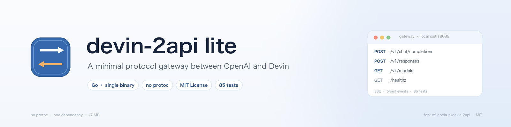
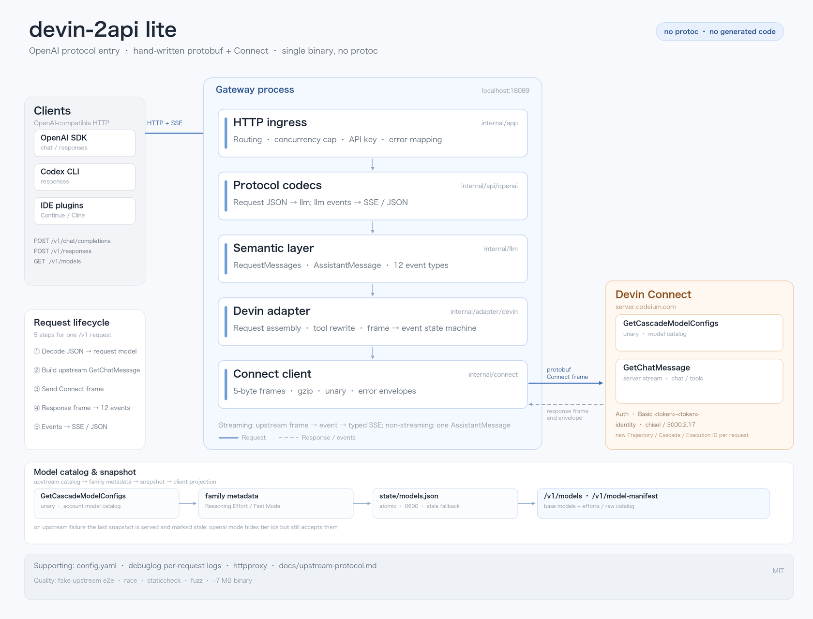

<div align="center">



**A minimal gateway that puts Devin behind any OpenAI-compatible client**

[](go.mod)
[](LICENSE)
[](https://github.com/Green-hats/devin-2api-lite/actions/workflows/ci.yml)
[](#what-it-is)
[](go.mod)

<b>English</b> | <a href="README.zh-CN.md">中文</a>

[Quick start](#quick-start) · [Endpoints](#endpoints) · [Configuration](#configuration) · [Credits](#credits)

</div>

---

> [!IMPORTANT]
> A trimmed, partially rewritten fork of [**leookun/devin-2api**](https://github.com/leookun/devin-2api).
> The protocol reverse-engineering, field semantics and most of the `llm` / HTTP / adapter code come from that
> project (MIT). This fork adds a hand-written protobuf + Connect layer.
> Per-file attribution is in [NOTICE](NOTICE).

## What it is

devin-2api lite speaks OpenAI (Chat Completions and Responses) and talks to Devin over its Connect RPC
`GetChatMessage`. Tools run in the client; the gateway translates one model turn at a time.

```text
OpenAI client ──HTTP/SSE──► devin-2api lite ──protobuf/Connect──► Devin
```

## Highlights

- **Two protocols** — Chat Completions and Responses, streaming or buffered.
- **Model catalog** — `/v1/models` with a 5-minute cache and `supports_images`.
- **Tool-aware** — strips schema annotations and moves descriptions into the system prompt.
- **Current-turn images** — base64 data URLs; rejected locally for non-vision models.
- **No protoc** — 63 upstream descriptors become a ~250-line wire codec; the only dependency is `yaml.v3`.

## Architecture



Request JSON → `llm.RequestMessages` → `GetChatMessage` frames → 12 event types → typed SSE or one JSON
response. Field numbers and framing are documented in
[`docs/upstream-protocol.md`](docs/upstream-protocol.md).

## Quick start

### 1. Get a token

On macOS, read the Devin session token from the app's local state:

```bash
sqlite3 ~/Library/"Application Support"/Devin/User/globalStorage/state.vscdb \
  "SELECT json_extract(value, '$.apiKey') FROM ItemTable WHERE key='windsurfAuthStatus';"
```

> [!WARNING]
> The token is your account credential. Keep it in a local `config.yaml` (git-ignored) and never share it.

### 2. Configure

```bash
git clone https://github.com/Green-hats/devin-2api-lite.git
cd devin-2api-lite
cp config.example.yaml config.yaml   # fill in devin.token
```

### 3. Check the token

```bash
go run ./cmd/devin-2api -config config.yaml -check
# config ... / upstream ... / models N (vision M) / configured found=true
```

This calls the upstream model catalog once and exits. It is the fastest way to confirm a token still works.

### 4. Run

```bash
go run ./cmd/devin-2api -config config.yaml
```

Or with Docker:

```bash
docker build -t devin-2api-lite .
docker run --rm -p 18089:18089 \
  -v "$PWD/config.yaml:/app/config.yaml" \
  devin-2api-lite --config /app/config.yaml
```

### 5. Verify

```bash
curl http://localhost:18089/healthz
# {"status":"ok"}
```

## Use it

| Setting | Value |
| --- | --- |
| Base URL | `http://localhost:18089/v1` |
| API key | `auth.api_key`; any non-empty string if unset |
| Model | `glm-5-2` or any uid from `/v1/models` |

```bash
curl -N http://localhost:18089/v1/chat/completions \
  -H "Content-Type: application/json" \
  -d '{
    "model": "glm-5-2",
    "messages": [{"role": "user", "content": "Hello"}],
    "stream": true
  }'
```

Any OpenAI-compatible client (OpenAI SDK, Codex CLI, IDE plugins) can point its Base URL here.

## Endpoints

| Endpoint | Method | Streaming | Notes |
| --- | --- | --- | --- |
| `/v1/chat/completions` | POST | SSE | `tools`, `stream_options.include_usage` |
| `/v1/responses` | POST | typed SSE | `input`, `instructions`, `tools` |
| `/v1/models` | GET | — | Catalog projection; see `catalog.model_mode` |
| `/v1/models/{model}` | GET | — | Single model |
| `/v1/model-manifest` | GET | — | Versioned catalog manifest (schema, families, hash, stale) |
| `/healthz` | GET | — | No auth, no concurrency limit |

Request bodies are capped at 32 MiB; unknown fields are ignored. Status codes: 503 when no token is
configured, 504 when the upstream stream is idle past `stream_idle_timeout`, 413 for oversized bodies.

## Configuration

Copy [`config.example.yaml`](config.example.yaml) to `config.yaml` and set `devin.token`;
base URL and model are already filled in the example. The full reference — all fields, environment overrides, reasoning
tiers, catalog snapshots and model modes — is in [docs/configuration.md](docs/configuration.md).

Unknown YAML fields are rejected. `-check` validates config and upstream; `-sync-models`
refreshes the catalog snapshot.

## Differences from the original

| | Original | lite |
| --- | --- | --- |
| Endpoints | chat, responses, models, Anthropic, WebSocket, panel | chat, responses, models, health |
| Upstream bindings | Generated Connect bindings | Hand-written wire + Connect |
| Build step | `task generate` | None |
| Dependencies | 7 | 1 (`yaml.v3`) |
| Production LOC | 8,851 | 7,438 |

The layer boundaries are unchanged; adding Anthropic or WebSocket back means adding one
codec package.

## Caveats

- **Unofficial.** This impersonates the Devin client protocol and may stop working at any time; it may also violate
  upstream terms. Not affiliated with Devin, Windsurf, Codeium or Cognition.
- **Fixed sampling.** `max_tokens=128000`, `temperature=1`, `top_k=40`, `top_p=0.95`; client values are ignored.
- **Current-turn images only.** Historical images are replaced with placeholder text.
- **No SOCKS5.** Use a local HTTP proxy port if needed.

## Development

```bash
go test -race ./...
go vet ./...
go install honnef.co/go/tools/cmd/staticcheck@2026.2.2
staticcheck ./...
gofmt -l .

# fuzz the hand-written protocol parsers
go test ./internal/adapter/devin -run=^$ -fuzz=FuzzDecodeChatResponse -fuzztime=10s
go test ./internal/connect -run=^$ -fuzz=FuzzReadFrame -fuzztime=10s

# verify hard-coded fields against a freshly extracted proto
go run ./cmd/fieldcheck /path/to/all-protos.proto

# refresh the model catalog snapshot on demand
go run ./cmd/devin-2api -config config.yaml -sync-models
```

## Credits

Protocol reverse-engineering, field semantics and much of `internal/llm`, `internal/api` and
`internal/adapter/devin` come from [**leookun/devin-2api**](https://github.com/leookun/devin-2api)
(MIT, © 2026 leookun). New here: `internal/connect`, the wire codec, the trimmed app/config, tests and docs.
Per-file details are in [NOTICE](NOTICE).

## License

[MIT](LICENSE) © 2026 leookun (original project) and Green-hats (lite modifications).
