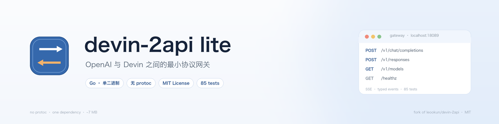
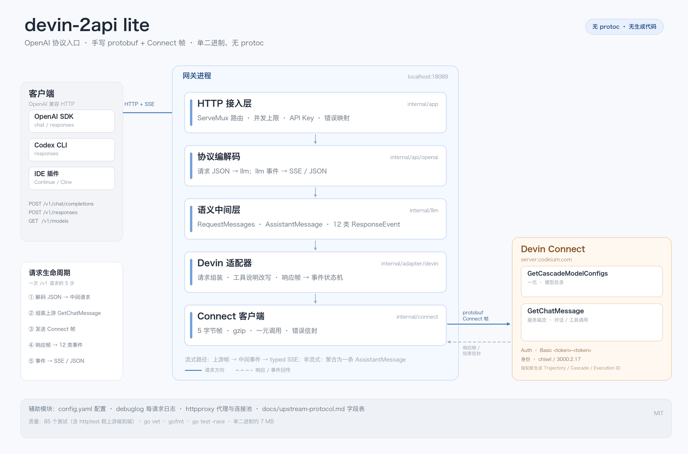

<div align="center">



**把 Devin 接进任何 OpenAI 兼容客户端的最小网关**

[](go.mod)
[](LICENSE)
[](https://github.com/Green-hats/devin-2api-lite/actions/workflows/ci.yml)
[](#这是什么)
[](go.mod)

<a href="README.md">English</a> | <b>中文</b>

[快速开始](#快速开始) · [接口](#接口) · [配置](#配置) · [来源](#来源)

</div>

---

> [!IMPORTANT]
> 这是 [**leookun/devin-2api**](https://github.com/leookun/devin-2api) 的裁剪重写版。协议逆向、字段语义与
> `llm` / HTTP / 适配器的大部分代码都来自原项目（MIT）。本仓库新增了手写的 protobuf + Connect 层。
> 逐文件署名见 [NOTICE](NOTICE)。

## 这是什么

devin-2api lite 对外说 OpenAI（Chat Completions 与 Responses），对内通过 Devin 的 Connect RPC
`GetChatMessage` 通信。工具由客户端执行，网关只负责一轮模型调用的协议转换。

```text
OpenAI 客户端 ──HTTP/SSE──► devin-2api lite ──protobuf/Connect──► Devin
```

## 亮点

- **双协议** —— Chat Completions 与 Responses，流式或非流式。
- **模型目录** —— `/v1/models`，5 分钟缓存，附带 `supports_images`。
- **工具调用** —— 剥离 Schema 注解，把工具说明注入 system prompt。
- **当前轮图片** —— base64 data URL；无视觉能力的模型在本地直接拒绝。
- **无 protoc** —— 63 个上游 descriptor 收敛为约 250 行 wire codec；唯一依赖 `yaml.v3`。

## 架构



请求 JSON → `llm.RequestMessages` → `GetChatMessage` 帧 → 12 类事件 → typed SSE 或一条 JSON 响应。
字段号与帧格式见 [`docs/upstream-protocol.md`](docs/upstream-protocol.md)。

## 快速开始

### 1. 获取 token

macOS 下从 Devin 应用本地状态读取：

```bash
sqlite3 ~/Library/"Application Support"/Devin/User/globalStorage/state.vscdb \
  "SELECT json_extract(value, '$.apiKey') FROM ItemTable WHERE key='windsurfAuthStatus';"
```

> [!WARNING]
> token 等同于账户凭据。只保存在本地 `config.yaml`（已被 git 忽略），不要分享或提交。

### 2. 配置

```bash
git clone https://github.com/Green-hats/devin-2api-lite.git
cd devin-2api-lite
cp config.example.yaml config.yaml   # 填入 devin.token
```

### 3. 自检

```bash
go run ./cmd/devin-2api -config config.yaml -check
# config ... / upstream ... / models N (vision M) / configured found=true
```

它会调用一次上游模型目录后退出，是确认 token 是否仍然可用的最快方式。

### 4. 运行

```bash
go run ./cmd/devin-2api -config config.yaml
```

或使用 Docker：

```bash
docker build -t devin-2api-lite .
docker run --rm -p 18089:18089 \
  -v "$PWD/config.yaml:/app/config.yaml" \
  devin-2api-lite --config /app/config.yaml
```

### 5. 验证

```bash
curl http://localhost:18089/healthz
# {"status":"ok"}
```

## 使用

| 配置项 | 值 |
| --- | --- |
| Base URL | `http://localhost:18089/v1` |
| API Key | `auth.api_key`；未设置时任意非空字符串 |
| Model | `glm-5-2` 或 `/v1/models` 返回的任意 uid |

```bash
curl -N http://localhost:18089/v1/chat/completions \
  -H "Content-Type: application/json" \
  -d '{
    "model": "glm-5-2",
    "messages": [{"role": "user", "content": "你好"}],
    "stream": true
  }'
```

OpenAI SDK、Codex CLI、IDE 插件等 OpenAI 兼容客户端，把 Base URL 指向这里即可。

## 接口

| 接口 | 方法 | 流式 | 说明 |
| --- | --- | --- | --- |
| `/v1/chat/completions` | POST | SSE | `tools`、`stream_options.include_usage` |
| `/v1/responses` | POST | typed SSE | `input`、`instructions`、`tools` |
| `/v1/models` | GET | — | 模型目录投影，见 `catalog.model_mode` |
| `/v1/models/{model}` | GET | — | 单个模型 |
| `/v1/model-manifest` | GET | — | 版本化模型目录（schema、families、hash、stale） |
| `/healthz` | GET | — | 不鉴权、不占并发 |

请求体上限 32 MiB；未知字段会被忽略。状态码：未配置 token 返回 503，上游流超过
`stream_idle_timeout` 无帧返回 504，请求体过大返回 413。

## 配置

把 [`config.example.yaml`](config.example.yaml) 复制为 `config.yaml`，填入 `devin.token`；
`base_url` 和 `model` 示例里已经填好。完整参考——所有字段、环境变量覆盖、推理档位、目录快照和展示模式——见
[docs/configuration.zh-CN.md](docs/configuration.zh-CN.md)。

未知 YAML 字段会被拒绝。`-check` 校验配置和上游；`-sync-models` 刷新目录快照。

## 与原版的区别

| | 原版 | lite |
| --- | --- | --- |
| 接口 | chat、responses、models、Anthropic、WebSocket、面板 | chat、responses、models、health |
| 上游绑定 | protoc 生成 Connect 绑定 | 手写 wire + Connect |
| 构建前置 | `task generate` | 无 |
| 依赖 | 7 个 | 1 个（`yaml.v3`） |
| 生产代码 | 8,851 行 | 7,438 行 |

分层边界没有变化；要加回 Anthropic 或 WebSocket，只需补一个编解码包。

## 注意事项

- **非官方。** 这是对 Devin 客户端协议的模拟，随时可能失效，也可能违反上游条款；与 Devin、Windsurf、
  Codeium、Cognition 无关联。
- **采样参数固定。** `max_tokens=128000`、`temperature=1`、`top_k=40`、`top_p=0.95`，客户端传值不生效。
- **图片仅当前轮。** 历史图片会替换为占位文本。
- **不支持 SOCKS5。** 需要时请使用本地 HTTP 代理端口。

## 开发

```bash
go test -race ./...
go vet ./...
go install honnef.co/go/tools/cmd/staticcheck@2026.2.2
staticcheck ./...
gofmt -l .

# 对手写协议解析器做模糊测试
go test ./internal/adapter/devin -run=^$ -fuzz=FuzzDecodeChatResponse -fuzztime=10s
go test ./internal/connect -run=^$ -fuzz=FuzzReadFrame -fuzztime=10s

# 校验硬编码字段号是否与最新提取的 proto 一致
go run ./cmd/fieldcheck /path/to/all-protos.proto

# 手动刷新模型目录快照
go run ./cmd/devin-2api -config config.yaml -sync-models
```

## 来源

协议逆向、字段语义以及 `internal/llm`、`internal/api`、`internal/adapter/devin` 的大部分代码来自
[**leookun/devin-2api**](https://github.com/leookun/devin-2api)（MIT，© 2026 leookun）。
本仓库新增：`internal/connect`、wire codec、裁剪后的 app/config、测试与文档。逐文件说明见 [NOTICE](NOTICE)。

## License

[MIT](LICENSE) © 2026 leookun（原项目）与 Green-hats（lite 版修改）。
